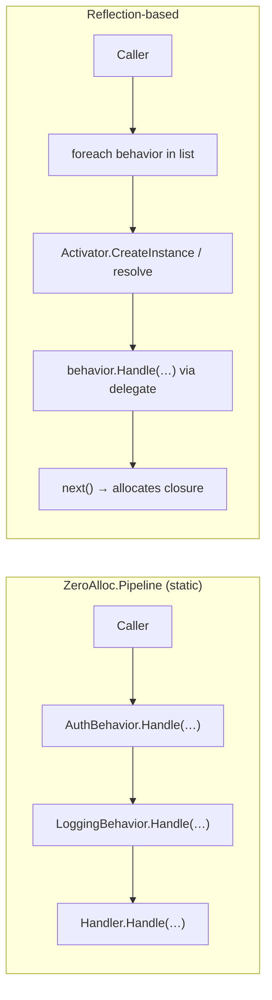

# Performance

ZeroAlloc.Pipeline emits static nested lambda call chains at compile time. No heap allocation occurs during pipeline dispatch itself.

## Why Reflection-Based Pipelines Allocate

A typical runtime-resolved pipeline (e.g. a `List<IPipelineBehavior>` iterated with a recursive delegate) allocates on every call because:

- A delegate object is created to represent `next` at each nesting level
- The behavior list is stored as a managed array or dictionary
- Virtual dispatch on the interface method boxes value types and prevents inlining

## How ZeroAlloc.Pipeline Eliminates Allocation

### Static lambda chains

The generator emits a tree of static lambdas at build time. Static lambdas are guaranteed not to capture any state, so the runtime never needs to allocate a closure object for them.

```csharp
// Conceptual — what the generator emits for two behaviors
return global::App.AuthBehavior.Handle<global::App.Ping, string>(
    request, ct,
    static (r1, c1) =>
        global::App.LoggingBehavior.Handle<global::App.Ping, string>(
            r1, c1,
            static (r2, c2) =>
                { var h = new PingHandler(); return h.Handle(r2, c2); }));
```

### No dictionary lookup

Behaviors are resolved by the generator — the compiled output contains direct `TypeName.Handle(...)` calls. There is no runtime lookup or switch.

### No virtual dispatch

`Handle` is called as a static method. The JIT inlines it freely without a virtual dispatch stub.

## Benchmark Results

Measured 2026-10-21 on an otherwise idle machine — [`tests/ZeroAlloc.Pipeline.Benchmarks`](../tests/ZeroAlloc.Pipeline.Benchmarks).

```
BenchmarkDotNet v0.15.8, Windows 11 (10.0.26300.9711)
12th Gen Intel Core i9-12900HK 2.50GHz, 1 CPU, 20 logical and 14 physical cores
.NET SDK 10.0.402
  [Host] : .NET 10.0.13 (10.0.13, 10.0.1326.50504), X64 RyuJIT x86-64-v3
```

> Allocations are exact. Speed is shown as same-run ratios; absolute timings are not published.

The comparison is **static chain** (what `PipelineEmitter.EmitChain` generates) vs a **pre-built delegate chain** (interface-based pipeline with chain allocated once at startup, not per call — the best achievable runtime alternative). Each benchmark ran out of process in three launches, pinned to two performance cores. `Ratio` is the delegate chain's mean time relative to the static chain with the same number of behaviors, in the same run; `Launch range` is the lowest and highest ratio of the three launches.

| Behaviors | Static chain | Pre-built delegate chain | Launch range | Allocated, both |
|---:|---:|---:|---:|---:|
| 1 | 1.00 | 1.03 | 0.93–1.60 | 0 B |
| 3 | 1.00 | **4.24** | 4.15–4.53 | 0 B |
| 5 | 1.00 | **3.72** | 3.54–4.03 | 0 B |

With **0 behaviors** both chains are below what BenchmarkDotNet can resolve, and it reports the static chain as a zero measurement: with no behavior in the way, the JIT folds the whole call. That row has no meaningful ratio and is left out.

**Key observations:**
- Both approaches allocate **0 B** per call when the delegate chain is pre-built.
- `EmittedChainAllocationTests` backs the static-chain 0 B: it discovers three behaviors, emits their chain with `PipelineEmitter.EmitChain`, compiles it, and asserts 0 B per call with `AllocationGate` on every test run.
- For 1 behavior the two are level; one of the three launches put the delegate chain 60% behind, the other two within 7%.
- For 3+ behaviors, the static chain wins decisively (3.7–4.2×) because the JIT inlines static calls transitively, collapsing the entire chain into straight-line code. Delegate dispatch cannot inline across virtual call sites.

## Static vs Reflection Dispatch



## Native AOT

ZeroAlloc.Pipeline is fully AOT-safe. Because all dispatch is static and resolved at compile time, there is nothing for the trimmer to remove and no reflection paths that need `[DynamicallyAccessedMembers]`.

```xml
<!-- No special configuration required -->
<PublishSingleFile>true</PublishSingleFile>
<PublishTrimmed>true</PublishTrimmed>
```

## When Zero Allocation Matters

**It matters for:**
- High-throughput services handling thousands of requests per second
- Hot paths in games, parsers, or real-time systems
- Services with strict GC pause budgets
- Applications targeting Native AOT

**It probably doesn't matter for:**
- CRUD endpoints doing database I/O (allocation is not the bottleneck)
- Background jobs that run infrequently
- Applications already dominated by third-party library allocations

## Tips for Maximum Performance

1. Keep `Handle` methods lean — expensive logic in a behavior negates the allocation win
2. Avoid capturing variables in `InnermostBodyTemplate` / `InnermostBodyFactory` — static lambdas must be capture-free
3. Use `FromAttributeSyntaxContext` in generators — reduces IDE latency during development
4. Sort behaviors by `Order` once (at generation time), not at runtime
